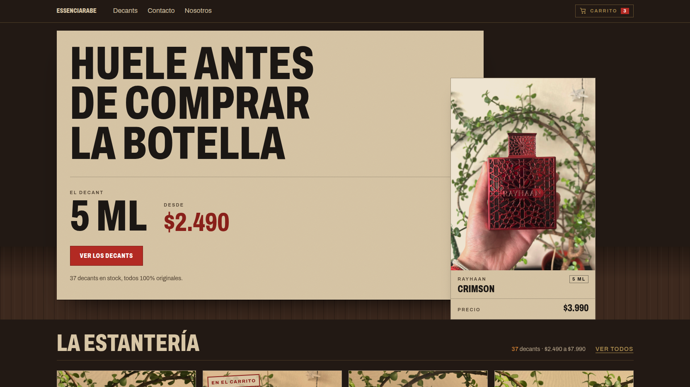
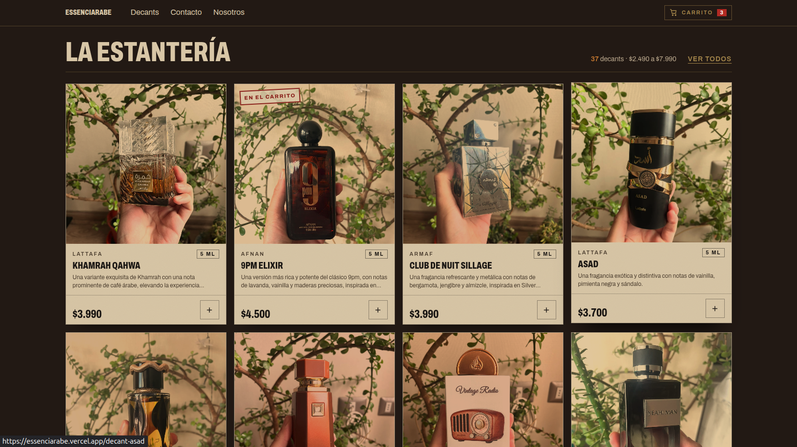
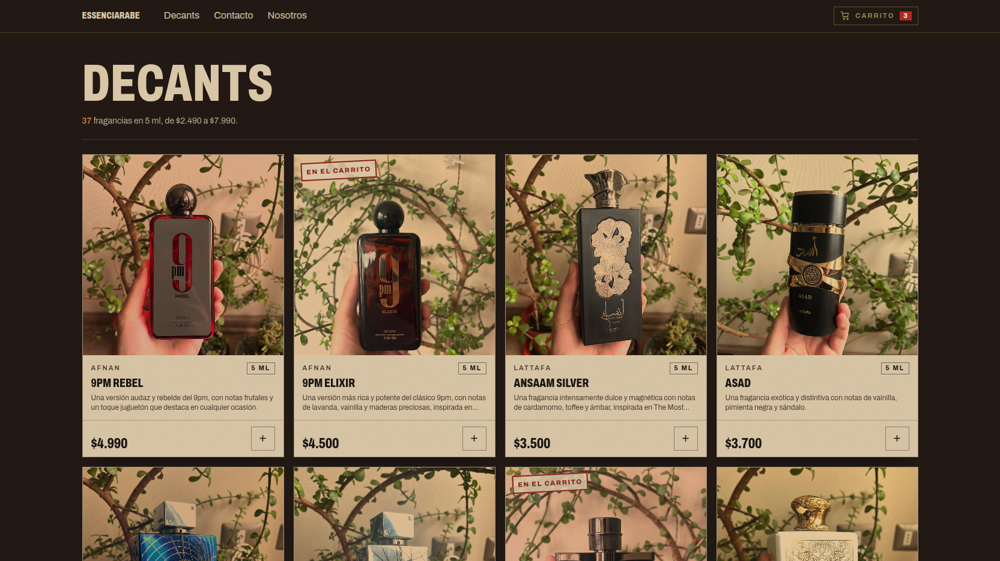
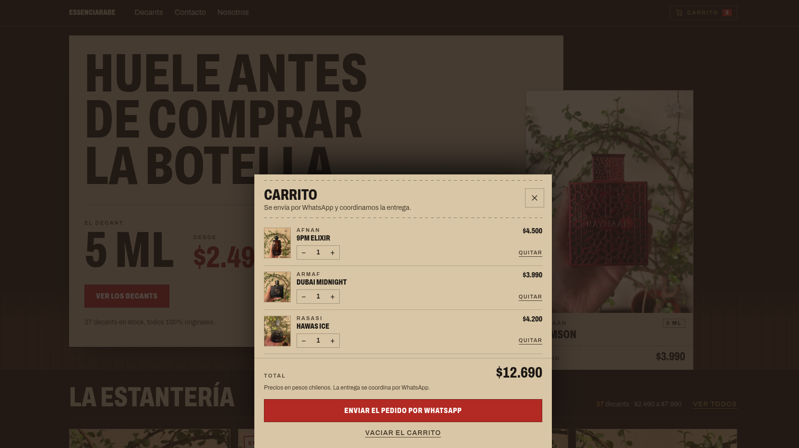

# Essenciarabe

**5 ml decants of original Arabic perfumes.** Smell it before you buy the bottle.

Essenciarabe is a small shop in Temuco, Chile. We sell the same perfume that comes in
the bottle, decanted in 5 ml portions, so you can try several fragrances before
committing to one.

---

## Screenshots

| Home | Estantería |
| --- | --- |
|  |  |

| Decants | Cart |
| --- | --- |
|  |  |

---

## What a decant is

A decant is the original perfume, transferred into a small 5 ml vial. It is not a
copy and not a store tester: it is the same fragrance, in an amount that lasts
several wears and lets you compare two or three scents before choosing one.

## What's in stock

- **37 decants in stock**, all 5 ml.
- **From $2.490 to $7.990.** 18 of them are priced at $3.990.
- **100% original.** Every decant comes from an original, sealed bottle.

The catalog only shows what is available today. If something is not listed, it is not
in stock: there are no sold-out items and no waiting lists.

## How to order

1. **Pick your decants.** Two or three 5 ml vials are enough to compare without
   spending a full bottle.
2. **Add them to the cart.** The cart is saved in your browser, so you can keep
   browsing without losing your picks.
3. **Send the order on WhatsApp.** The message is pre-filled with the items and the
   total.
4. **We coordinate.** A person replies, confirms stock, and agrees on delivery or
   pickup with you.

There is no payment gateway and no user account: the purchase ends in a conversation.

## Delivery

Delivery is coordinated, in Temuco and nearby: we agree on a place and time over
WhatsApp. We do not use a carrier, we do not charge a shipping rate calculated on the
site, and we do not promise deadlines we cannot meet.

## Authenticity

Every perfume is sold as **100% original**. That is the condition for being in the
catalog, not a badge: if we cannot stand behind it, we do not sell it.

## Contact

| Channel | |
| --- | --- |
| WhatsApp | [+56 9 6539 0562](https://wa.me/56965390562) |
| Instagram | [@essenciarabe](https://instagram.com/essenciarabe) |
| Email | [essenciarabe@gmail.com](mailto:essenciarabe@gmail.com) |

**Opening hours:** Monday to Friday, 8:00 to 20:00.

## FAQ

**Do you sell full bottles?**
No. The catalog is 5 ml decants only. If you already know the perfume and want the
bottle, you can get it wherever it is sold; here you can try it first.

**How long does a 5 ml decant last?**
Several wears. It is meant to actually wear the perfume, not just smell it once.

**Are the decants original?**
Yes. They come from original, sealed bottles and are decanted by hand.

**How do I pay?**
The order is closed over WhatsApp: stock, delivery, and payment method are confirmed
there.

**Do you ship to other cities?**
Delivery is arranged case by case over WhatsApp. The site does not calculate shipping
rates or delivery times.

---

© 2026 Essenciarabe · Temuco, Chile
